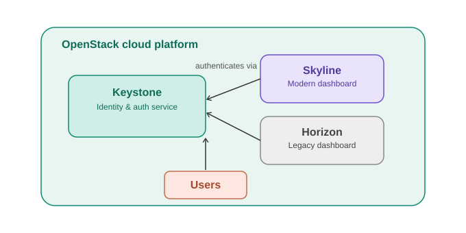
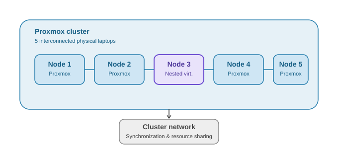

# INSA Cloud Computing Internship — Project Summaries

During my 5-month Cloud Computing internship at **Information Network Security Administration (INSA)**, Ethiopia's national cybersecurity agency, I worked on two major initiatives. Because this internship was with a government cybersecurity agency, I'm sharing high-level summaries and general architecture concepts here rather than internal documentation, configurations, or screenshots — in line with standard confidentiality practices for this kind of work.

---

## ☁️ Skyline Dashboard Integration

**What it was:** Integrated Skyline, a modern React-based dashboard, with Keystone authentication as an alternative to the default OpenStack Horizon interface.

**What I did:**
- Researched how Skyline's API server communicates with core OpenStack identity services (Keystone)
- Scoped the integration requirements needed to authenticate users through Keystone within Skyline
- Successfully implemented and deployed the integration within the cloud platform

**Concepts involved:** OpenStack, Keystone identity management, React, multi-tenant authentication flows

*See the illustration below for a general (non-internal) view of how a Skyline–Keystone integration typically fits into an OpenStack architecture.*

 

---

## 🖥️ Portable Private Cloud Datacenter

**What it was:** A distributed private cloud environment built across five interconnected physical laptops, simulating a small-scale enterprise datacenter.

**What I did:**
- Deployed a Proxmox Hypervisor node using nested virtualization, configured as one node in a 5-node cluster
- Participated in cluster formation, resolving network configuration conflicts between Proxmox and the underlying VMware environment
- Helped achieve stable multi-node synchronization across the cluster

**Concepts involved:** Proxmox clustering, nested virtualization, distributed systems, network troubleshooting

*See the illustration below for a general (non-internal) view of a multi-node Proxmox cluster architecture.*

---

### A note on confidentiality

Specific configurations, internal architecture details, credentials, and implementation documentation from this internship are not included here, in keeping with standard practice for cybersecurity agency work. The diagrams and descriptions above reflect general, publicly-understood concepts related to the technologies used — not INSA's actual internal systems.

For more detail on this experience, feel free to reach out — I'm happy to discuss it directly.