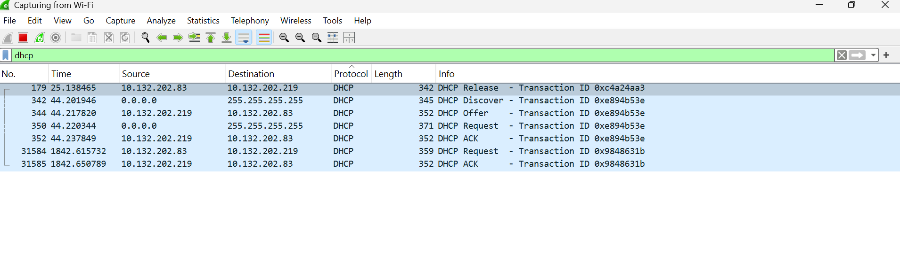

# DHCP DORA analysis (Wireshark)

Captured on my laptop's Wi-Fi interface, using `ipconfig /release` and `ipconfig /renew` to force a new exchange.

## Packet table

| Frame | Source IP | Destination IP | UDP ports (src, dst) | Message | Key fields |
|---|---|---|---|---|---|
| 342 | 0.0.0.0 | 255.255.255.255 | 68, 67 | Discover | Message type 1. Client IP 0.0.0.0. Transaction ID 0xe894b53e. |
| 344 | 10.132.202.219 | 10.132.202.83 | 67, 68 | Offer | Message type 2. Offered IP 10.132.202.83. Server identifier 10.132.202.219. Lease about 1 hour. Mask 255.255.255.0. Router and DNS 10.132.202.219. |
| 350 | 0.0.0.0 | 255.255.255.255 | 68, 67 | Request | Message type 3. Requested IP 10.132.202.83. Server identifier 10.132.202.219 (the server whose offer was accepted). |
| 352 | 10.132.202.219 | 10.132.202.83 | 67, 68 | ACK | Message type 5. Confirmed IP 10.132.202.83. Lease about 1 hour. |

The Offer, Request, and ACK all agree on the same address (10.132.202.83), and the router, DNS server, and DHCP server are all the same device (10.132.202.219).

## What I learned

### Why Discover goes from 0.0.0.0 to 255.255.255.255

When the client starts, it has no IP address and doesn't know who can give it one. So it broadcasts the Discover to 255.255.255.255 from source 0.0.0.0, which is like asking the whole network, "Does anybody have an IP address for me?" Only DHCP servers answer.

### Why all four packets have the same Transaction ID

The client picks a random Transaction ID at the start (here 0xe894b53e) and the server copies it into its replies. The client then uses it to match each reply to its own request, which matters because many devices share the network. The Release (frame 179) has a different ID, 0xc4a24aa3, because it belongs to a separate conversation.

### What the Offer contains

The Offer carries the address being offered, the identifier of the server making the offer, the subnet mask, the default gateway, the DNS server, and the lease time. The lease time says how long I can keep the address. The client doesn't wait until the end of that time, though; it starts renewing earlier (see below).

### Ports 67 and 68

In my Discover, the source port is 68 and the destination port is 67. In the Offer they are reversed: source 67, destination 68. Port 67 is the DHCP server and port 68 is the DHCP client. Both sides use fixed ports, so the client's DHCP software can receive the server's reply even though the client doesn't have an address configured yet, and the traffic is easy to recognize and filter.

## Lease renewal

Later in the same capture, frames 31584 (Request) and 31585 (ACK) appear about 1842 seconds in, with no Discover or Offer before them. The first exchange finished at about 44 seconds, so the gap is roughly 1798 seconds, close to 30 minutes, which is half of the 1-hour lease. So my laptop started renewing at the halfway point, well before the lease ran out.

These two packets also go directly between 10.132.202.83 and the server (10.132.202.219) instead of being broadcast. The client already has an address and already knows which server gave it, so it has no reason to ask everyone.

I also noticed that after my `ipconfig /release` (frame 179), the server gave me the same address back, 10.132.202.83.