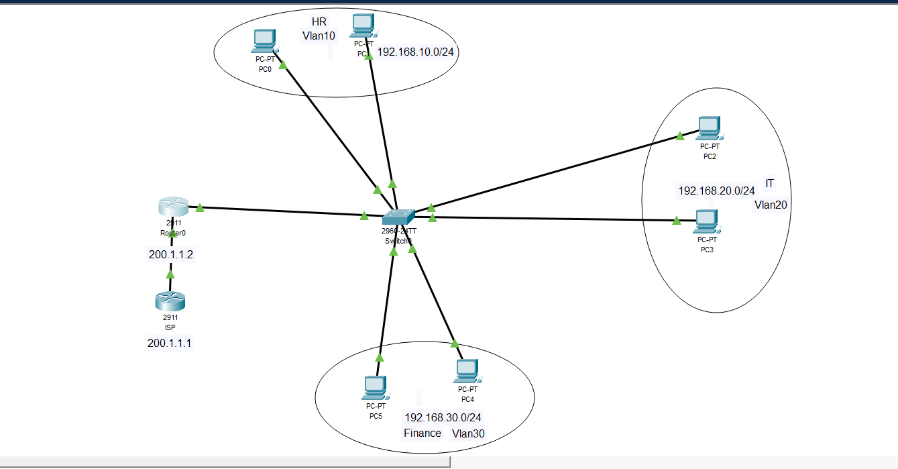
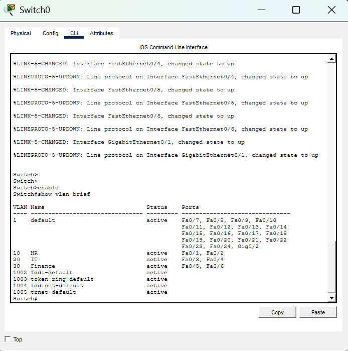
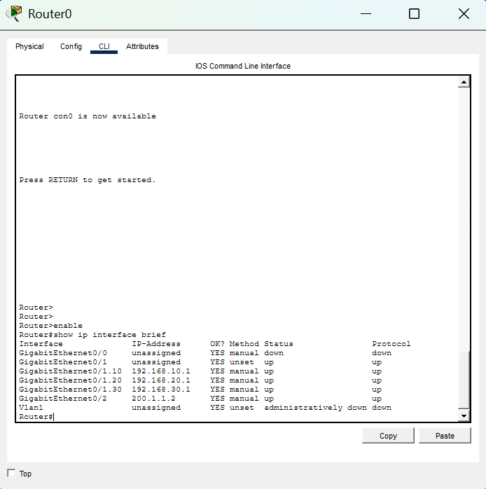
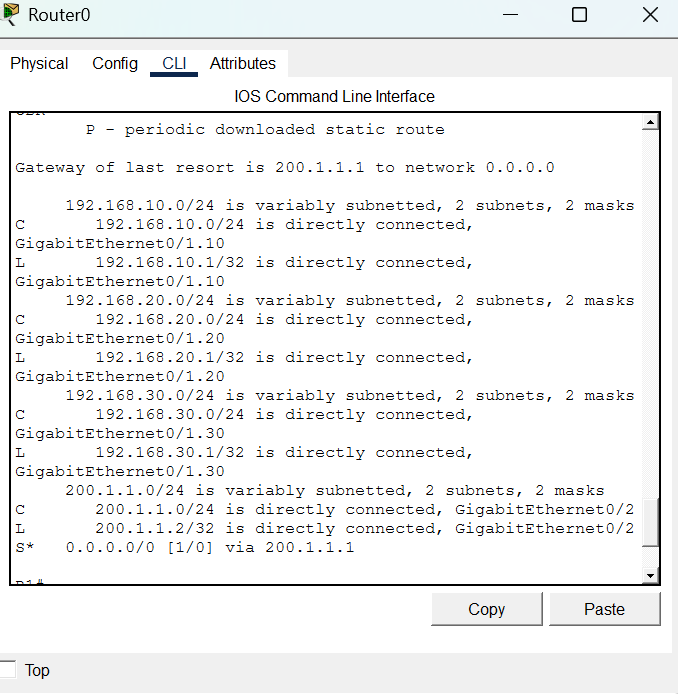
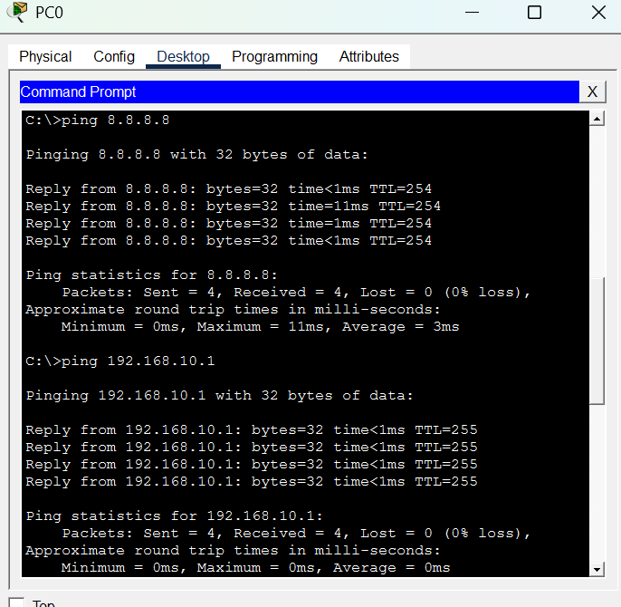
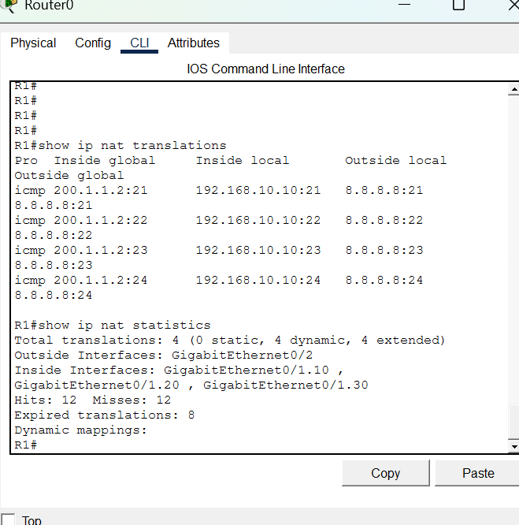

# Project 1: Small Enterprise Network (VLANs, Inter-VLAN Routing, DHCP, PAT)

**Tool:** Cisco Packet Tracer

## Overview

A small office network with three departments (HR, IT, Finance), each in its own VLAN. One router connects the VLANs using router-on-a-stick, hands out addresses by DHCP, and translates internal addresses to a single public address (PAT) to reach an external network. A second router plays the role of the ISP, with a loopback address (8.8.8.8) standing in for a server on the internet.

## Topology

## Addressing table

| Device | Interface | Address | Role |
|---|---|---|---|
| R1 | Gi0/1 | none | Trunk to SW1 |
| R1 | Gi0/1.10 | 192.168.10.1/24 | HR gateway (VLAN 10) |
| R1 | Gi0/1.20 | 192.168.20.1/24 | IT gateway (VLAN 20) |
| R1 | Gi0/1.30 | 192.168.30.1/24 | Finance gateway (VLAN 30) |
| R1 | Gi0/2 | 200.1.1.2/24 | NAT outside, link to ISP |
| ISP | Gi0/0 | 200.1.1.1/24 | Link to R1 |
| ISP | Loopback0 | 8.8.8.8/32 | Simulated internet server |
| SW1 | Gi0/1 | none | Trunk to R1 (VLANs 10, 20, 30) |
| SW1 | Fa0/1-2 | none | Access, VLAN 10 (HR) |
| SW1 | Fa0/3-4 | none | Access, VLAN 20 (IT) |
| SW1 | Fa0/5-6 | none | Access, VLAN 30 (Finance) |

| VLAN | Name | Subnet | DHCP range |
|---|---|---|---|
| 10 | HR | 192.168.10.0/24 | .10 - .254 |
| 20 | IT | 192.168.20.0/24 | .10 - .254 |
| 30 | Finance | 192.168.30.0/24 | .10 - .254 |

PCs get their addresses from R1's DHCP pools. Addresses .1 to .9 in each subnet are excluded so they stay free for infrastructure.

## What was configured

- **VLANs and trunk (SW1):** VLANs 10, 20, and 30 with access ports for each department. Gi0/1 is an 802.1Q trunk to R1, restricted to VLANs 10, 20, and 30.
- **Inter-VLAN routing (R1):** router-on-a-stick, with one subinterface per VLAN using `encapsulation dot1Q`.
- **DHCP (R1):** one pool per VLAN, each handing out the subinterface address as the default gateway.
- **PAT (R1):** `ip nat inside` on the three subinterfaces, `ip nat outside` on Gi0/2, and an overload rule using ACL 1 to match the three internal subnets.
- **Default route (R1):** `ip route 0.0.0.0 0.0.0.0 200.1.1.1`, so traffic to destinations beyond the ISP link has somewhere to go.

Full device configs are in [`configs/`](configs/). The Packet Tracer file is [`project-01.pkt`](project-01.pkt).

## How to verify

| Check | Command or action | Expected result |
|---|---|---|
| VLANs exist and ports are assigned | `show vlan brief` (SW1) | HR, IT, Finance with the right ports |
| Trunk is up | `show interfaces trunk` (SW1) | Gi0/1 trunking, VLANs 10, 20, 30 allowed |
| Subinterfaces are up | `show ip interface brief` (R1) | Gi0/1.10, .20, .30 up/up |
| DHCP works | `ipconfig` on a PC | Address in 192.168.x.10+, correct gateway |
| Inter-VLAN routing works | Ping a PC in another VLAN | Replies received |
| Default route is present | `show ip route` (R1) | `S*` route to 0.0.0.0/0 via 200.1.1.1 |
| Internet reachability | `ping 8.8.8.8` from a PC | Replies received |
| PAT is translating | `show ip nat translations` (R1), run right after a ping | Inside local 192.168.x.x mapped to inside global 200.1.1.2 |

Screenshots:

| Evidence | File |
|---|---|
| VLANs on SW1 |  |
| Router subinterfaces |  |
| DHCP on a client |  |
| Routing table with default route |  |
| Ping to 8.8.8.8 |  |
| NAT translations and statistics |  |

## Known limitations

- The native VLAN is still VLAN 1, and unused switch ports are not shut down or moved to an unused VLAN.
- No device hardening: no SSH, no enable secret, no password encryption.
- DHCP pools do not hand out a DNS server.
- Single router and single switch, so there is no redundancy.
- 8.8.8.8 is a loopback on the ISP router, not the real internet.

## Files

- `project-01.pkt`: Packet Tracer file with all configurations
- `topology.png`: network diagram
- `configs/`: exported device configs and `show` command output
- `screenshots/`: verification evidence
